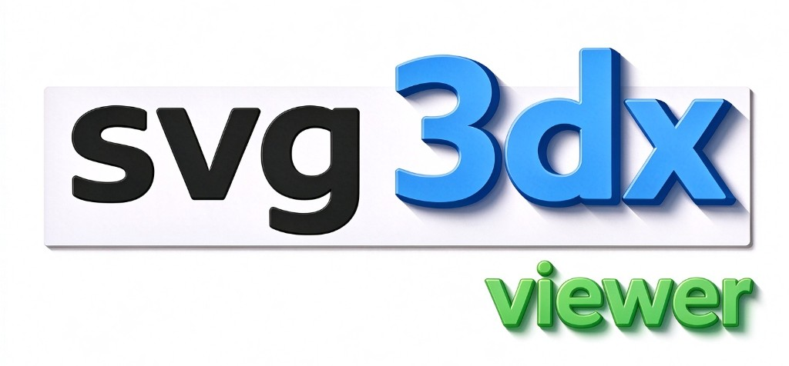

<p align="center">
  
</p>

# svg3dx-viewer

[中文](README.zh-CN.md) | English

Embeddable **viewer component** for svg3dx: render parametric 3D recipes in a page and expose an editable external-params panel. Kept deliberately light — click-to-select / highlight and other editor interactions are layered by the host (e.g. studio's `interact`).

## Related libraries

| Repository | Role |
|------------|------|
| [svg3dx](https://github.com/xiaohunqupo/svg3dx) | Format specification and samples |
| [svg3dx-core](https://github.com/xiaohunqupo/svg3dx-core) | Parse / evaluate engine (WASM) |
| **svg3dx-viewer** (this repo) | Embeddable viewer component |
| [svg3dx-studio](https://github.com/xiaohunqupo/svg3dx-studio) | svg3dx editor |

## Install

```bash
npm install svg3dx-viewer three
```

Peer: `three >= 0.160.0`. Runtime WASM comes from dependency `svg3dx-ffi-wasm`. Bundlers need WASM support (e.g. Vite + `vite-plugin-wasm`).

## Develop

Sibling checkouts of `svg3dx-core`, `svg3dx` (samples), and this repo:

```powershell
cd ..\svg3dx-core
.\scripts\build-release.ps1   # or at least wasm-pack → pkg/

cd ..\svg3dx-viewer
npm install
npm run dev                   # examples/embed
```

## CI

GitHub Actions (`.github/workflows/ci.yml`) on `main` / PR:

1. Checkout sibling `svg3dx-core` + `svg3dx`
2. `wasm-pack` → core `pkg/`
3. `tsc` library build + Vite embed example
4. Upload `dist` / `examples/embed-dist` artifacts

## Embedding

```ts
import { createViewer } from "svg3dx-viewer";

const viewer = await createViewer(document.getElementById("view")!, {
  paramsEl: document.getElementById("params")!,
});
await viewer.loadSvg(svgText);
viewer.setParams({ H: 120 }); // only direct :root literals are accepted
```

API: `createViewer` / `loadSvg` / `setParams` / `getParams` / `setModel` / `ParamPanel`.

Viewport chrome is toggleable (on by default):

- `modelBar` — top-left Model dropdown
- `paramsBar` — collapsible Params under Model (edits re-evaluate immediately)
- `viewHelper` — top-right orientation gizmo

## License

MIT OR MulanPSL-2.0.
