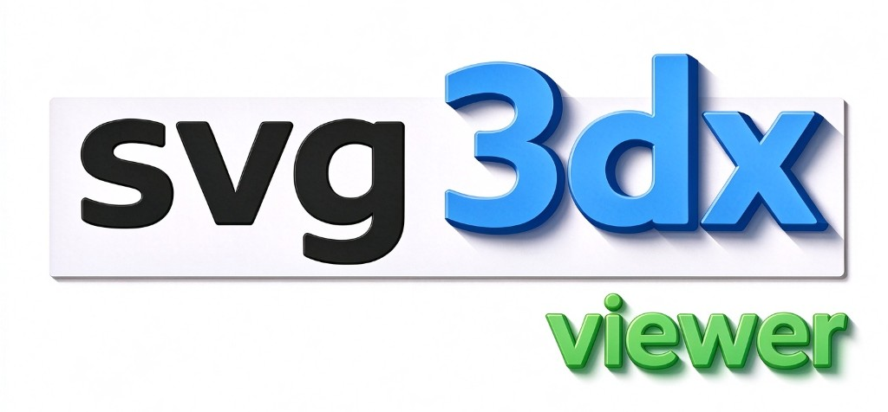

<p align="center">
  
</p>

# svg3dx-viewer

[English](README.md) | 中文

svg3dx **查看器组件**（Viewer）：可嵌入网页，渲染三维配方，并提供可编辑的外部参数列表。定位为轻量显示；点击选中 / 高亮等编辑向交互由宿主（如 studio 的 `interact`）自行叠加。

## 关联库

| 仓库 | 职责 |
|------|------|
| [svg3dx](https://github.com/xiaohunqupo/svg3dx) | 格式规范与 samples |
| [svg3dx-core](https://github.com/xiaohunqupo/svg3dx-core) | 解析求值引擎（WASM） |
| **svg3dx-viewer**（本仓） | 嵌入式查看器组件 |
| [svg3dx-studio](https://github.com/xiaohunqupo/svg3dx-studio) | svg3dx 编辑器 |

## 安装

```bash
npm install svg3dx-viewer three
```

peer：`three >= 0.160.0`。运行时 WASM 来自依赖 `svg3dx-ffi-wasm`。打包器需支持 WASM（如 Vite + `vite-plugin-wasm`）。

## 开发

本机需并列：`svg3dx-core`、`svg3dx`（示例）、本仓。

```powershell
cd ..\svg3dx-core
.\scripts\build-release.ps1   # 或至少 wasm-pack 产出 pkg/

cd ..\svg3dx-viewer
npm install
npm run dev                   # examples/embed
```

## CI

GitHub Actions（`.github/workflows/ci.yml`）在 `main` / PR 上：

1. 检出并列仓 `svg3dx-core`、`svg3dx`
2. `wasm-pack` → core `pkg/`
3. `tsc` 库构建 + Vite embed 示例
4. 上传 `dist` / `examples/embed-dist` 产物

## 嵌入用法

```ts
import { createViewer } from "svg3dx-viewer";

const viewer = await createViewer(document.getElementById("view")!, {
  paramsEl: document.getElementById("params")!,
});
await viewer.loadSvg(svgText);
viewer.setParams({ H: 120 }); // only direct :root literals are accepted
```

API：`createViewer` / `loadSvg` / `setParams` / `getParams` / `setModel` / `ParamPanel`。

动画（草案 0.2 SMIL 形子集）：含 `<s3dx:animate>` / `<s3dx:animateTransform>` 的文档在 `loadSvg` 后自动播放。控制：`setAnimationPlaying` / `getAnimationPlaying` / `resetAnimationClock` / `hasDocumentAnimations`。

视口控件均可开关（默认开启）：

- `modelBar` — 左上角 Model 下拉
- `paramsBar` — Model 下方可折叠 Params（改参立刻重评）
- `viewHelper` — 右上角方位控件

## 许可证

MIT OR MulanPSL-2.0。
